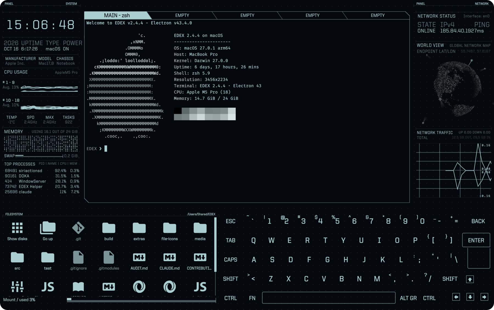
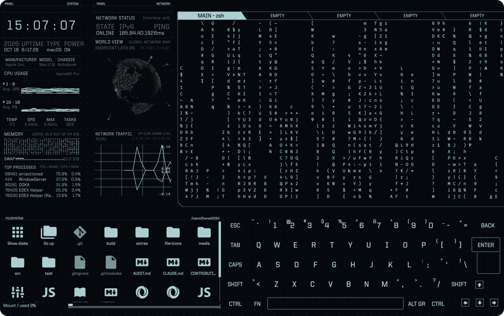
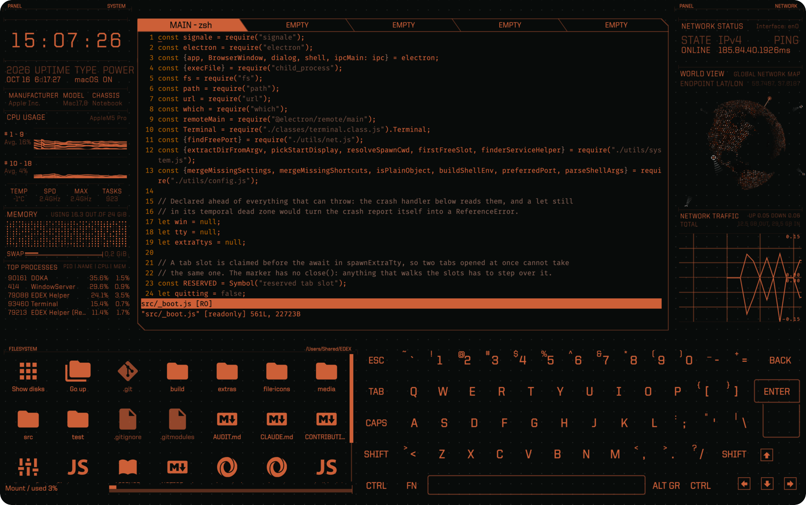
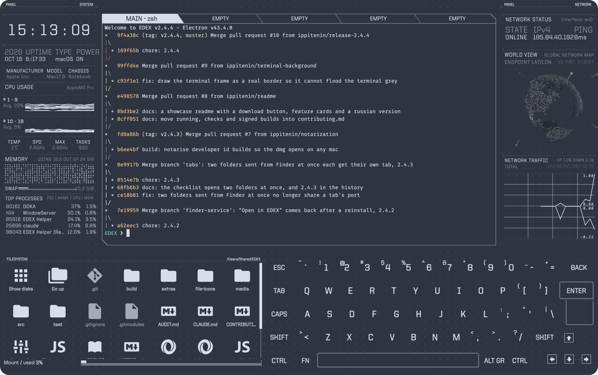

<p align="center">
  
</p>

<h1 align="center">EDEX</h1>

<p align="center">
  <b>A sci-fi terminal for macOS, built for Apple silicon.</b><br>
  Native arm64, Electron 43, a hardened shell — and quiet by default.
</p>

<p align="center">
  <b>English</b> · <a href="README.ru.md">Русский</a>
</p>

<p align="center">
  <a href="https://github.com/ippitenin/EDEX-macOS/releases/latest"></a>
  
  
  <a href="LICENSE"></a>
</p>

<p align="center">
  <a href="https://github.com/ippitenin/EDEX-macOS/releases/latest/download/EDEX-macOS-arm64.dmg"></a>
  <br>
  <sub>Apple silicon · macOS 12 or later · signed and notarized by Apple</sub>
</p>

<p align="center">
  
</p>

EDEX is a fullscreen terminal and system monitor that looks like a computer from a science
fiction film. It grew out of eDEX-UI, which was archived in 2021 at v2.2.8 on Electron 12, and
has since become an app of its own — a daily driver on a current Mac.

## What the fork brings

<table>
  <tr>
    <td width="50%" valign="top">
      <h3>⚡ Native Apple silicon</h3>
      Built for arm64 instead of running x64 through Rosetta. Idle CPU drops from about 600% to about 40%.
    </td>
    <td width="50%" valign="top">
      <h3>🧬 Electron 12 → 43</h3>
      Chromium 89 → 150, current electron-builder and <code>node-pty</code>, refreshed dependencies.
    </td>
  </tr>
  <tr>
    <td width="50%" valign="top">
      <h3>🔒 A hardened shell</h3>
      The terminal socket listens on <code>127.0.0.1</code> only and checks who connects. File and process names are escaped, paths are quoted before they reach the shell.
    </td>
    <td width="50%" valign="top">
      <h3>🪟 A real macOS window</h3>
      Title bar, resize, move it around. <kbd>Ctrl</kbd>&nbsp;<kbd>Shift</kbd>&nbsp;<kbd>M</kbd> sends it to the next display — fullscreen included.
    </td>
  </tr>
  <tr>
    <td width="50%" valign="top">
      <h3>📂 Open in EDEX</h3>
      Right-click a folder in Finder and get a terminal in it, in a free tab if EDEX is already running.
    </td>
    <td width="50%" valign="top">
      <h3>🧲 Drop files, get paths</h3>
      Files dropped on the window are typed in as escaped paths, the way Terminal does it.
    </td>
  </tr>
  <tr>
    <td width="50%" valign="top">
      <h3>🔇 Quiet by default</h3>
      No sound on every keystroke or line of output. Enter keeps its confirmation, the boot sequence keeps its own.
    </td>
    <td width="50%" valign="top">
      <h3>⌨️ Any keyboard layout</h3>
      The on-screen keyboard lights up by physical key under any input source, and Cyrillic gets a matching font.
    </td>
  </tr>
</table>

<details>
<summary><b>Full list of changes from upstream</b></summary>

The fork's changes began on **2026-08-14** and are described per-commit in `git log`. The
security review behind them, and its follow-up, is written up in [AUDIT.md](AUDIT.md).

### Runtime and packaging
- **Electron 12 → 43** (Chromium 89 → 150), electron-builder 22 → 26, `electron-rebuild` →
  `@electron/rebuild`, `@electron/remote` 1 → 2, `node-pty` 0.10 → 1.1.
- **Native Apple Silicon build.** Upstream shipped x64, which ran through Rosetta and burned
  roughly 600% CPU while idle. Native arm64 brings that to about 40%.
- Refreshed `nanoid`, `pdfjs-dist`, `smoothie`, `systeminformation`, `ws`; `tar` pinned to
  >= 7.5.21 through `overrides` (transitive, critical advisory).

### Security fixes
- **The terminal websocket binds to `127.0.0.1` only** and verifies `Origin`, accepting just
  the local renderer loaded from `file://`. Upstream listened on every interface and accepted
  whichever client connected first — the long-standing eDEX-UI exposure. Without the Origin
  check, a web page open in a browser could connect to the local port and drive the shell.
- **Untrusted values are escaped before they reach the DOM** — process names, file names, volume
  labels, the contents of a file opened in the editor, keyboard layout files, values from
  `settings.json`, error text. Upstream interpolated them raw, which with node integration
  enabled meant a file named `` executed code the moment it was displayed.
  See [AUDIT.md](AUDIT.md).
- **Paths typed into the shell are quoted properly** — from the fuzzy finder and from clicks in
  the filesystem panel alike — so a folder named `$(curl …|sh)` or `'; rm -rf ~; '` stays a name.
- **Theme and keyboard layout names stay inside their folders**; a crafted name used to load a
  file from anywhere.
- **pdf.js updated** from 2.16 to 4.10, with `eval` disabled in the viewer (CVE-2024-4367).
- **Dependencies are not advisory-free right now.** As of 2026-09-30 `npm audit` reports high
  severity advisories against Electron 43.4.0 itself and the `undici` it bundles; moving to a
  patched Electron is a separate update, not part of this release.
- **The update checker is gone.** It fetched releases from the upstream repository on every
  launch and dropped the response into modal markup, `onclick` handler included.

### Interface
- Renamed to EDEX throughout; settings live in `~/Library/Application Support/EDEX` and are
  migrated once from the old eDEX-UI folder.
- **Layout fixed for tall, non-16:9 displays.** Key widths were expressed in `vh`, which only
  lines up on 16:9; they are now `vw`, so rows, Enter and the spacebar stay in place.
- **The window is an ordinary window.** Upstream ran frameless and screen-sized in native
  fullscreen, with no close, minimise or zoom buttons, and refused to be moved or resized — so a
  second monitor was unreachable, since macOS cannot drag a window out of native fullscreen at all.
  It now opens with a title bar, filling the work area of the chosen display. `forceFullscreen` is
  off by default and editable in the settings editor rather than only in the JSON.
- **Quiet by default:** no sound on keystrokes, terminal output, modals or directory
  refreshes. Enter keeps its confirmation sound, and the start-up sequence keeps its own.
- The glitch title screen is skipped — the boot log hands straight over to the UI.
- **The startup animation lands where it started.** The terminal frame used to unfold, blink and
  jump to a different spot, and the keyboard spread across the whole screen before snapping into
  its corner. The frame now opens where it stays, and the keyboard fades in where it stands —
  together with the filesystem panel, which no longer waits for the side columns.
- `LANG` defaults to `ru_RU.UTF-8` when unset; without it Cyrillic input came out as digits.
- **Cyrillic in the interface font.** United Sans has none, so Russian file names were drawn in
  the system fallback — wider and heavier than the Latin next to them. Play's Cyrillic is now
  registered under the theme font's own name and fills the gap in every theme.
- **The on-screen keyboard lights up by physical key.** It used to match the character typed, so
  under a Russian input source the letters stayed dark.
- **A long path stays inside the filesystem panel.** It used to run out of the title bar and
  across the keyboard; now it takes the whole bar when it needs to and, past that, drops folders
  from the middle — `/Users/me/…/src/utils`.
- RAM watcher no longer errors out on macOS memory accounting.

### Added
- **`Ctrl+Shift+M` sends the window to the next display**, wrapping around at the end. It works
  in fullscreen too: the window steps out of its Space, moves and goes back in. Beats the
  `monitor` setting, which lists bare indices and only takes effect on a full restart.
- **Defaults are merged into an existing config on every launch**, so a setting or shortcut added
  in a new version reaches people who already have a `settings.json` — previously the defaults were
  written on first run only and never revisited. Values already in the file are left alone.
- **"Open in EDEX"** — right-click a folder in Finder, get a terminal in it. The entry sits in
  the main context menu next to Terminal's own, and opens the folder in a free tab when EDEX is
  already running. A small Swift agent embedded in the bundle publishes the service, since
  Electron cannot register one itself, and EDEX registers the agent with macOS on every launch.
  See [extras/](extras/).
- **Files dropped on the window are typed into the active tab as paths**, escaped the way
  Terminal.app does it. That is also what lets Claude Code turn a dropped image into an
  attachment.


</details>

## Themes

EDEX ships with 21 themes, from Tron to Nord. Three of them:

<table>
  <tr>
    <td width="33%"></td>
    <td width="33%"></td>
    <td width="33%"></td>
  </tr>
  <tr>
    <td align="center"><sub>Tron Disrupted</sub></td>
    <td align="center"><sub>Blade · vim</sub></td>
    <td align="center"><sub>Nord · git log</sub></td>
  </tr>
</table>

## Install

1. Download **[EDEX-macOS-arm64.dmg](https://github.com/ippitenin/EDEX-macOS/releases/latest/download/EDEX-macOS-arm64.dmg)** from the latest release.
2. Open it and drag EDEX to Applications.
3. Launch it. macOS asks for access to the Desktop, Documents and Downloads folders — the file
   panel needs them; declining only hides those folders.

After the first launch, right-click any folder in Finder → **Open in EDEX**.

Requires a Mac with Apple silicon and macOS 12 or later. Other platforms are inherited from
upstream and left untouched — the fork is only tested on macOS arm64.

## Security

The fork went through a security review, written up in [AUDIT.md](AUDIT.md); how to report a
problem is in [SECURITY.md](SECURITY.md). One limitation is inherited from the original design:
the renderer runs with `nodeIntegration: true` and `contextIsolation: false`. The injection paths
found in the review are closed, but there is no second line of defence — treat the app as
trusting whatever you open with it. Moving to a preload bridge is a rewrite of the
window-to-main plumbing and has not been attempted.

<details>
<summary><b>Version history</b></summary>

- **2.4.4** (2026-10-16) — the terminal is dark again. Its frame was a half-transparent fill with
  the middle cut out, and Chromium sometimes dropped the cut-out, turning the whole terminal grey;
  the frame is now a plain border, and the page's dot grid no longer shows inside it.
- **2.4.3** (2026-09-30) — two folders sent from Finder in quick succession each get their own tab.
  The second used to connect to the first one's shell, fail with an error dialog and leave its own
  shell running with no tab.
- **2.4.2** (2026-09-30) — "Open in EDEX" is back in the Finder menu. macOS registers the app but
  not the service agent inside it, so after a reinstall the entry was gone; EDEX now registers the
  agent itself on every launch.
- **2.4.1** (2026-09-30) — a tidy-up after the summer's branches, and the holes it turned up.
  Clicking a folder in the filesystem panel no longer runs anything in its name; file contents,
  volume labels, settings values and theme names are escaped or confined; the one-client limit on
  the terminal socket works. Quitting during start-up, a tab whose socket fails, any value in
  `shellArgs`, unreadable files and directories, empty fuzzy searches and fast PDF paging no longer
  crash or leave shells behind, and a custom `env` survives the settings editor. Underneath, the
  logic moved into tested helpers (121 tests), dead code and sounds went, and the Finder helper is
  compiled for the architecture being packaged.
- **2.4.0** (2026-09-30) — the on-screen keyboard follows any input language, files dropped on the
  window are typed in as paths, Russian names get a matching font, a long path stays inside the
  filesystem panel, the startup animation lands where it started, and the filesystem panel
  arrives with the keyboard and lists everything. A dev server on port 3000 no longer stops the
  app from starting (2026-09-11).
- **2.3.0** (2026-08-27) — an ordinary window with a title bar, `Ctrl+Shift+M` onto the next
  display, and `npm run start-app` to run from source as EDEX.
- **2.2.8 + fork** (2026-08-14 to 2026-08-16) — Electron 43 on native arm64, the security audit and
  its fixes, "Open in EDEX" in Finder, signing that keeps permissions, and non-ASCII directory names.


</details>

## Build from source

```sh
npm run install-darwin   # dependencies, with node-pty rebuilt for Electron
npm start                # run from source
```

Tests, signed builds and the conventions of the codebase are in [CONTRIBUTING.md](CONTRIBUTING.md).

## Credits and attribution

eDEX-UI was created by **Gabriel "Squared" SAILLARD** ([gaby.dev](https://gaby.dev)) and
contributors, © 2017–2021. All of the original credits — including IceWolf for the sound
design and Rob "Arscan" Scanlon for the ENCOM Globe — are preserved in
[README.upstream.md](README.upstream.md).

This fork is maintained by Ilya Pitenin and carries no endorsement from the original author.
Please do not report issues with this fork to the upstream project.

## License

GPL-3.0, inherited from eDEX-UI — see [LICENSE](LICENSE) and [NOTICE.md](NOTICE.md).

As a derivative work this fork is distributed under the same terms: source is available, the
original copyright notices are kept, and the modifications are documented above and in the
commit history.
